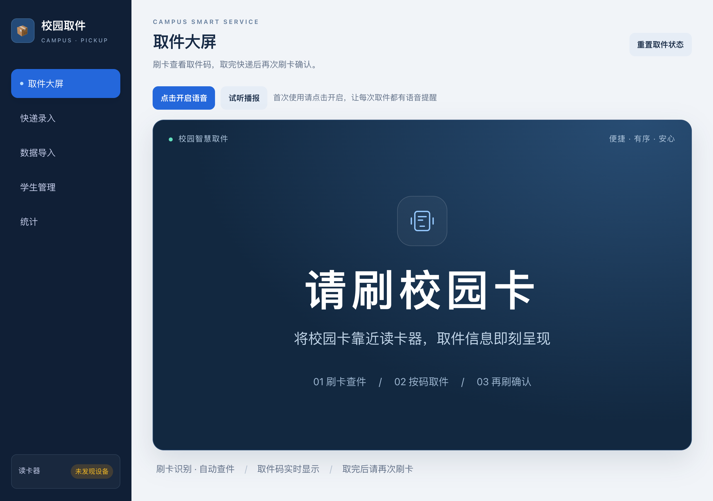
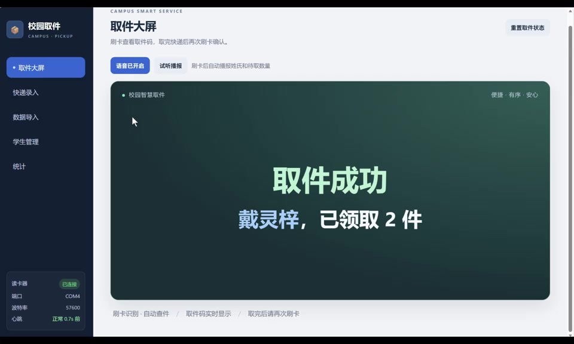

# 校园 RFID 取件系统

面向驿站现场的单系统：大字取件屏、中文语音、学生登记与绑卡、快递录入、Excel/CSV 导入、取件确认和统计。



## 下载与资料

- 点击本页绿色 **Code → Download ZIP**，下载后先完整解压。
- [图文操作说明 Word](docs/user-guide.docx)
- [操作视频](docs/operation-demo.mp4)（若网页未播放，点击 Download raw file 下载后观看）。

[](docs/operation-demo.mp4)

公开包从空数据库开始，不含原系统的学生、手机号、卡号或快递记录。截图中的资料为演示数据。

## 谁可以使用

任何人都可以下载，在自己连接硬件的电脑上运行；各电脑的数据独立保存在本机。准备：

1. Windows 或 macOS 电脑，安装 [Python 3.10 或更新版本](https://www.python.org/downloads/)，浏览器建议使用当前版本 Chrome 或 Edge。
2. 恺乐 **KL9007U** USB RFID 读写器、配套数据线及设备要求的电源/天线。
3. 与该设备兼容、可读取 EPC 的 UHF RFID 卡/标签。普通 13.56 MHz 校园卡不一定兼容，请先核对卡片和读写器规格。
4. 音箱或电脑扬声器；系统安装中文语音。首次安装程序依赖需要联网。

本程序通过本机 USB 串口访问读卡器，支持 UHFReader18 协议帧和自动波特率协商。不同固件或设备设置仍需实机验收。**只打开 GitHub 页面不会读取 USB 硬件**；后台必须运行在连接读卡器的电脑上。

## 首次启动

1. 连接 KL9007U，关闭占用它的厂家调试工具等软件。
2. 从 Python 官网安装 Python。Windows 使用传统安装器时勾选 **Add Python to PATH**；也可使用官方 Python 安装管理器。
3. 完整解压本项目，不要在 ZIP 内运行。
4. Windows 双击 `启动_Windows.bat`；macOS 双击 `启动_Mac.command`。首次启动自动创建 `.venv` 并安装 Flask、pyserial，只影响本项目。
5. 浏览器会自动打开 [本机系统](http://127.0.0.1:6066/)。如果没有自动打开，手动输入该地址。保持启动窗口开启。
6. 检查页面左下角设备显示“已连接”、心跳正常。点击“点击开启语音”，再点“试听播报”。

macOS 如果解压后启动文件不能双击，可在项目文件夹打开终端，执行：

```sh
python3 start.py
```

Windows 也可在项目文件夹终端执行：

```powershell
py -3 start.py
```

如果系统未识别 USB 串口，先核对设备实际 USB 芯片，再从芯片厂家获取匹配系统/处理器架构的驱动。CH340/CH341 可参考沁恒官方 [Windows 驱动](https://www.wch.cn/downloads/CH341SER_EXE.html) 和 [macOS 驱动](https://www.wch.cn/downloads/CH341SER_MAC_ZIP.html)。Windows ARM64 用户需使用对应架构驱动，不能混用 x64 驱动。

## 第一次使用

1. **学生管理**：登记姓名、手机号，点击“等待刷卡”绑定该学生的卡；未知卡也可在取件屏下方绑定。
2. **快递录入**：输入取件码和收件手机号，核对姓名。需批量处理时，先导入学生，再导入快递；支持 `.xlsx`、`.xlsm`、`.csv`、`.txt`，不支持旧 `.xls`。
3. **取件大屏**：开启语音。第一次刷卡显示待取码、播报“某同学，有 N 个待取件”，此时尚未标记已取。
4. 移开卡片，按码找齐全部包裹；卡片移开至少 3 秒后，在 5 分钟内再次刷同一张卡，确认该学生的全部待取件已取。
5. 只取部分快递时，由工作人员在快递列表中逐件“标已取”。无待取时显示并播报无待取件。

**重置取件状态会将全部快递恢复待取**，只用于确认过的演示初始化，不能当作普通清屏按钮。

## 多设备与外网的含义

- GitHub 是公开下载和资料入口；外部使用者下载后，在自己的电脑上连接读卡器并运行。
- `127.0.0.1` 指使用者当前电脑；把这个地址发给别人，无法访问你的电脑或你的数据库。
- 本发布版默认仅监听本机，没有管理员登录与多人权限。不要直接将它通过路由器或公网隧道开放运营。集中多站点联网需要另行建设带身份验证的服务及本地读卡网关。
- 每台运行后台的电脑独立保存资料；下载代码不会自动连接你的驿站，也不会同步数据。

## 端口与设备排查

- **6066 被占用**：先关闭旧的系统启动窗口，再启动一份。不要同时运行多个后台抢占读卡器。
- **未发现设备**：换一根支持数据传输的 USB 线，检查供电、驱动、设备管理器中的 COM 口；macOS 查看 USB 串口。
- **设备无响应**：关闭厂家测试工具，检查天线、电源及协议设置；读卡线程会重试并自动协商波特率。
- **多个串口时**：可指定端口。Windows PowerShell：`$env:RFID_PORT='COM7'; py -3 start.py`。macOS：`RFID_PORT=/dev/cu.wchusbserialXXXX python3 start.py`。替换成实际端口。
- **没声音**：先点击语音按钮，检查浏览器/系统静音、音箱及中文语音；每次刷新网页后需重新开启。
- **页面无数据**：公开包初始为空，需先录入自己的学生和快递。

## 停机 备份与更新

结束操作后在启动窗口按 Ctrl+C，服务停止后备份 `data/pickup.db`。该文件包含现场个人资料，不要提交到 GitHub。`.gitignore` 已排除数据库、备份、虚拟环境和日志，但上传其他文件前仍需检查。

更新时先停机备份，在新文件夹解压新版，再将自己的 `data/pickup.db` 复制到新版同名位置。不要让空数据库覆盖现场数据库。当前统计日按 UTC 零点划分，北京时间 08:00 切换，日结需核对记录时间。

## 验证与维护

```sh
python -m pip install -r requirements.txt
python -m unittest discover -s tests -v
```

自动检查覆盖空数据库、两次刷卡流程、持续读卡防误确认、确认超时、绑卡刷新、取消等待、CSV 导入、静态文件隔离、协议帧及指定串口。这些测试不连接真实硬件；实际部署仍需检查本机驱动、卡片、声音以及 KL9007U 的读卡结果。

为避免误触发，模拟刷卡接口默认关闭；开发测试可临时设置 `RFID_ENABLE_SIMULATION=1`，正式使用不要开启。

第三方依赖及本地 Vue 文件遵循各自许可证，见 [第三方说明](THIRD_PARTY_NOTICES.md)。
